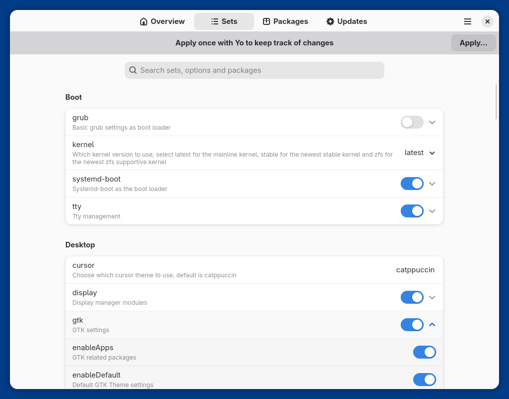
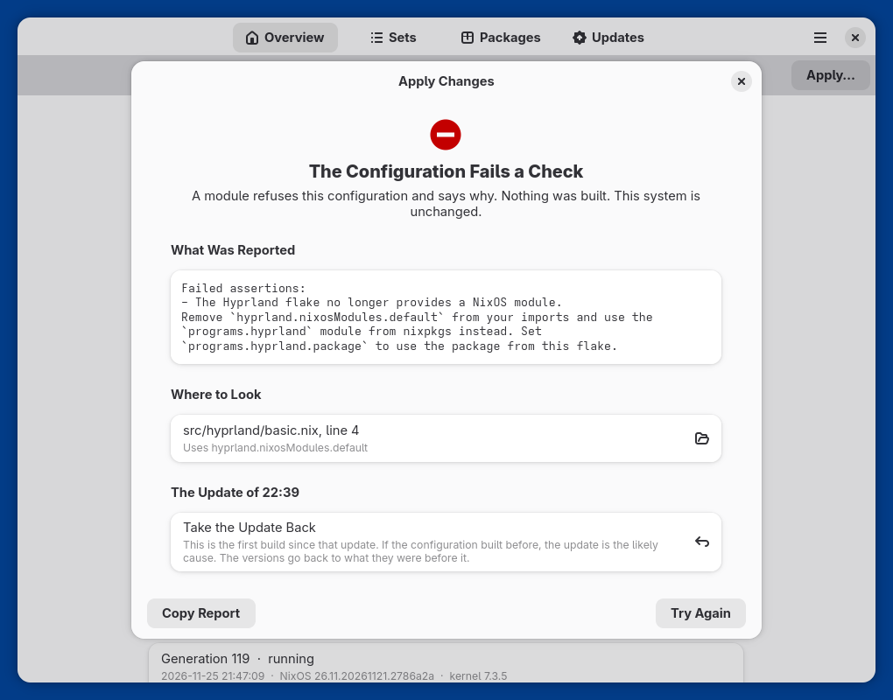

# presez (Sez's Dotfiles)

<p align="center"></p>

## Introduction
NixOS is of perfect functionalities. In a reproducible paradigm, modualised frameworks are built around the system. Should users being bothered by the back-and-forth modifications and looking ups in their ricing, or just daily maintanance attempts, a better solution pipelining monads shall be introduced in some way. The NixOS internalised rolling back system enjoyers shall also expect a well-functional rolling back, and more, system working inside their concise dotfile directories. 

By modualising the dotfile flake, we are now able to describe what to use and what not to use in a sole profile file in a pre-configured modualised manner, which is also friendly to beginners. Should you assume I'm building a CLI simply integrating commands, the project actually aims to achieve something like a local version controller. Users may build various versions of profiles of configuration, which maps to the NixOS version-ised system profiles, and they can be reused and branches may be maded deviating from profiles, creating a well-founded baseground for system config hoppers.

Details of the helper (yo) may be found in [How To Use](#how-to-use) below.

## My toolchain
|                            | NixOS-unstable (With flakes and [flake-parts](https://github.com/hercules-ci/flake-parts))                                                                                    |
|----------------------------|:-----------------------------------------------------------------------------------------------------------:|
| **Colour Scheme**          | [Catppuccin-Frappé](https://github.com/catppuccin/catppuccin)                                               |
| **Window Manager**         | [Hyprland](https://github.com/hyprwm/Hyprland)                                                              |
| **Terminal Emulator**      | [Wezterm](https://wezfurlong.org/wezterm/), [Alacritty](https://github.com/alacritty/alacritty)             |
| **Bar**                    | [Eww](https://github.com/elkowar/eww)                                                                       |
| **Shell**                  | [Nushell (primary)](https://github.com/nushell/nushell), [Xonsh (login)](https://github.com/xonsh/xonsh)    |
| **Text Editor**            | [GNU Emacs](https://www.gnu.org/software/emacs/)                                                            |
| **Browser**                | [Firefox](www.mozilla.org/en-GB/), [Nyxt](https://nyxt.atlas.engineer/)                                     |
| **Fetch**                  | [Hyfetch](https://github.com/hykilpikonna/hyfetch)                                                          |
| **Input method framework** | [Fcitx5-Rime](https://github.com/fcitx/fcitx5-rime)                                                         |
| **File Manager**           | [LF](https://github.com/gokcehan/lf), [Dolphin](https://apps.kde.org/en-gb/dolphin/)                        |
| **Application Launcher**   | [Rofi-wayland](https://github.com/lbonn/rofi)                                                               |
| **Notification Daemon**    | [Dunst](https://github.com/dunst-project/dunst)                                                             |
| **Display Manager**        | [sddm-corners](https://github.com/aczw/sddm-theme-corners)                                                  |
| **Lock Screen**            | [swaylock-effects](https://github.com/mortie/swaylock-effects)                                              |
| **Fonts**                  | [JetBrains-mono](https://www.jetbrains.com/lp/mono/), [Nerd fonts](https://github.com/ryanoasis/nerd-fonts) |
| **English**                | [en_GB](https://www.bbc.com/culture/article/20170904-how-americanisms-are-killing-the-english-language)     |

## How it is organised

The file system is the namespace: where a file lives is what it is called, and nothing is listed twice.

```
src/<package>/<variant>.nix     packages that need configuring
modules/<category>/<name>.nix   sets: switchable groups of packages and settings
profiles/<user>/<machine>/      profiles: what a user's machine gets
core/                           always-on plumbing (user, home-manager aliases, yo)
lib/                            the small library that turns the tree into NixOS modules
yo/                             the helper that manages all of this
```

**Packages.** Each variant under `src/` is an ordinary NixOS module, and knows nothing about how it is switched on:

```nix
# src/bat/basic.nix
{ config, lib, pkgs, inputs, ... }:

{
  home.programs.bat.enable = true;
}
```

A package without a directory needs no file at all: selecting its `basic` variant installs `pkgs.<package>`. An optional `meta.nix` next to the variants says what `yo` should know about the package: a description, the flake inputs it owns, and how to refresh what it pins.

**Sets.** `modules/dev/python.nix` is the set `dev.python`, switched on with `modules.dev.python.enable`. Most sets are plain data, which `yo` can read and edit:

```nix
{
  description = "the Python toolchain";
  packages = [ "python313" { git = [ "basic" "user" ]; } ];   # a bare name means the basic variant
  sets = [ "dev.git" ];                                        # other sets to switch on
  config = { };                                                # plain NixOS options
}
```

A set that needs its own options or logic is written as a function instead, and is then a NixOS module like any other.

**Profiles.** `profiles/<user>/<machine>` becomes the system `<user>-<machine>`. A `profile.nix` is data too: the user's holds what all their machines share, the machine's adds to it or overrides single values. Every other `.nix` file in those directories is a module for whatever does not fit that shape.

```nix
# profiles/sezrienne/azuki/profile.nix
{
  modules.hardware.x1nano2.enable = true;
  packages = [ "sober" "tradingview" ];
  exclude = [ ];
}
```

## How to use

NOTICE: Ignore all my narcissistic words in the [Introduction](#introduction) above, currently the project is still based for my own personal use. Where I kept an attic faith following conducts for global reproduciblity, lots of configs still are in the "works on my and my neighbourhood's machines" stage, so be careful if you simply clone and build everything.

Everything goes through `yo`, in a terminal or in a window (`yo gui`). On a machine that does not have it yet, `./bin/yo` runs it straight from the working tree.

```sh
$ yo                          # where things stand
$ yo init                     # a profile for this user and machine
$ yo list sets                # what there is, and what is on
$ yo enable dev/zig           # switch a set on (--shared: for all my machines)
$ yo add ripgrep              # select a package; --to <set> puts it in a set
$ yo option shell.defaultShell fish
$ yo why ripgrep              # what selects a package
$ yo new set dev/zig zig zls  # a new set
$ yo new package zig          # give a package a file under src/ to configure it in
$ yo update --check           # which pinned versions are behind
$ yo update t3code            # refresh one package's pins (or everything, without a name)
$ yo update --undo            # take the latest update back, should it not build
$ yo switch                   # build, show what changes, switch
$ yo rollback                 # back to the previous generation
```

<p align="center"></p>

`yo` only ever edits files in this repository; the system changes when you `yo switch`. Edits are made in place, so comments and formatting survive, and each one is checked by evaluating the result before it is written.

When a build fails, `yo` says what failed in a sentence, shows what Nix reported without the trace around it, and names the file of this repository that it is about; everything that was printed is one step away. An update that no system was built from yet is the first suspect, so a failure right after one offers to take it back.

<p align="center"></p>
